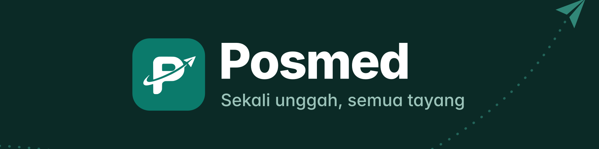

  

  <b>Auto posting video pendek ke YouTube Shorts, TikTok, Instagram Reels, dan Facebook dari satu tempat.</b> 
  Pakai Posmed Cloud, atau pasang gratis di servermu sendiri.

  <a href="https://posmed.id">posmed.id</a>

---

### Apa itu Posmed

Posmed adalah penjadwal video pendek untuk kreator dan tim yang mengelola banyak akun. Unggah satu video, pilih akun tujuan, atur jam tayang, lalu Posmed yang mengirimkannya ke tiap platform.

- **Satu unggahan, banyak platform.** YouTube Shorts, TikTok, Instagram Reels, dan Facebook Reels.
- **Jadwal yang kelihatan.** Kalender per minggu, geser untuk pindah jam, peringatan kalau jadwal bentrok.
- **Aman kalau gagal.** Coba ulang otomatis, notifikasi lewat email dan Telegram, riwayat setiap pengiriman.
- **Bisa diotomasi.** REST API, CLI, MCP untuk asisten AI, webhook, dan feed kalender.

### Dua cara pakai

| | Posmed Cloud | Community Edition |
| --- | --- | --- |
| Untuk | Yang ingin langsung pakai | Yang ingin memasang sendiri |
| Tempat | [app.posmed.id](https://app.posmed.id) | Docker atau Cloudflare Workers milikmu |
| Biaya | Mulai gratis | Gratis, open source (AGPL-3.0) |

Community Edition sedang disiapkan untuk rilis publik.

---

Posmed dibuat di Indonesia. Posmed is a short video scheduler for YouTube Shorts, TikTok, Instagram Reels, and Facebook, available as a hosted service or a self-hosted, open source edition.
